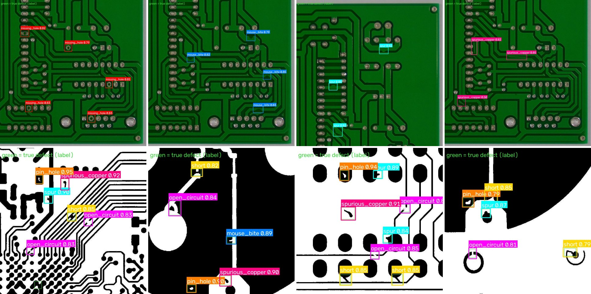
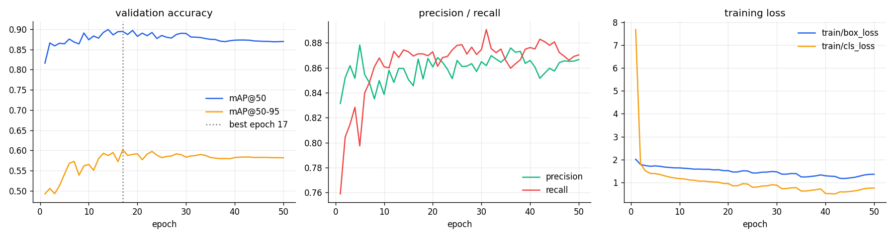
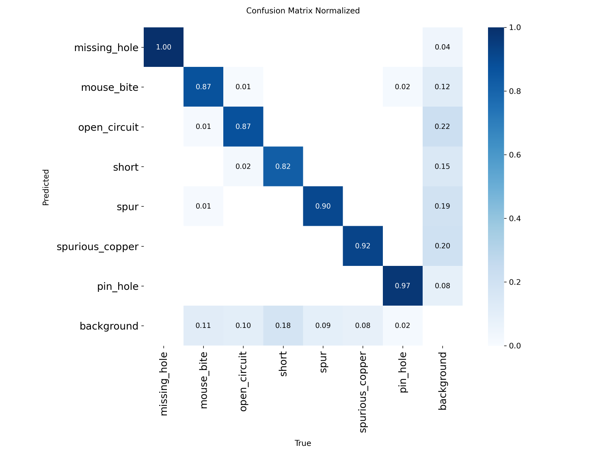
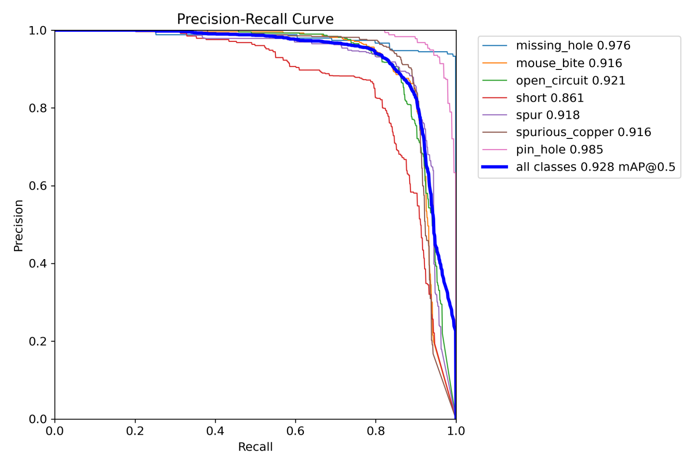
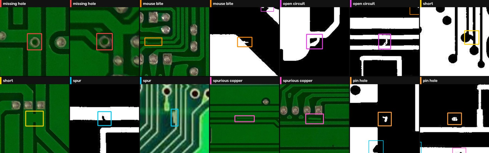
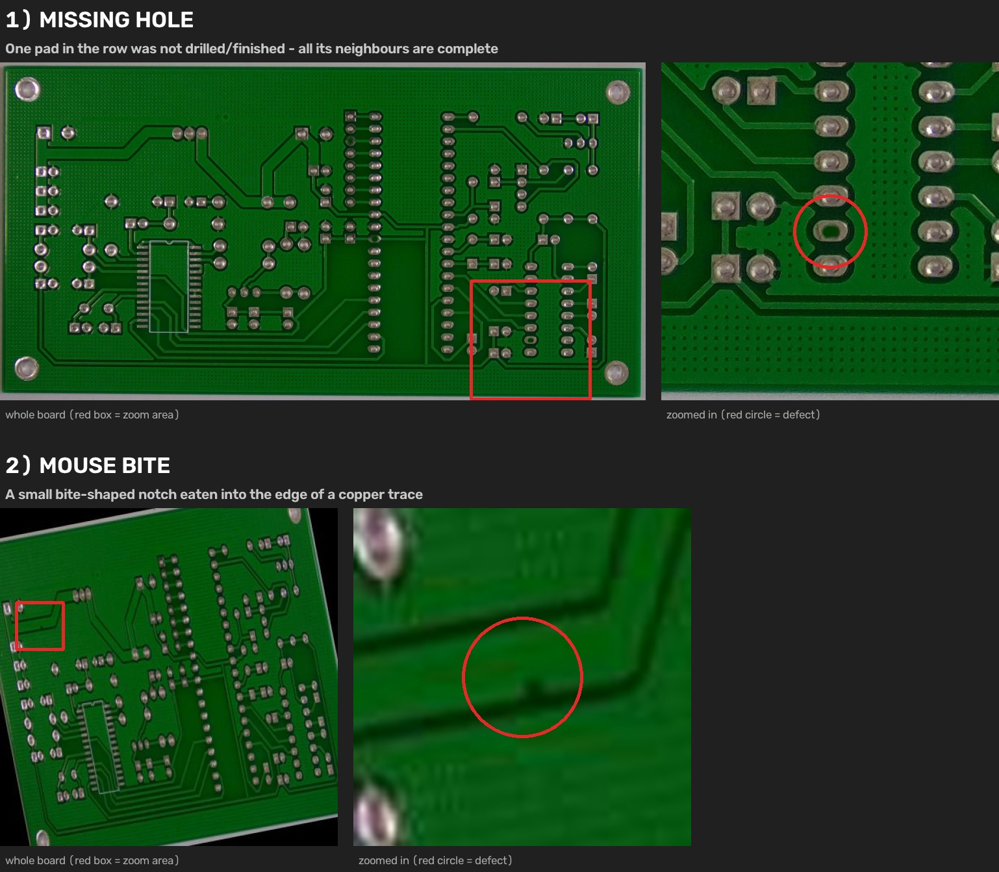
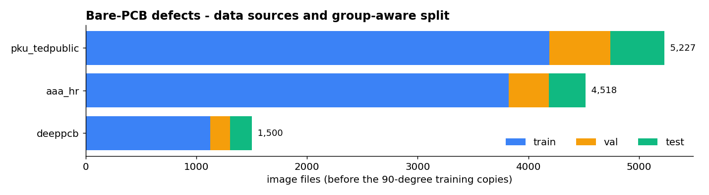
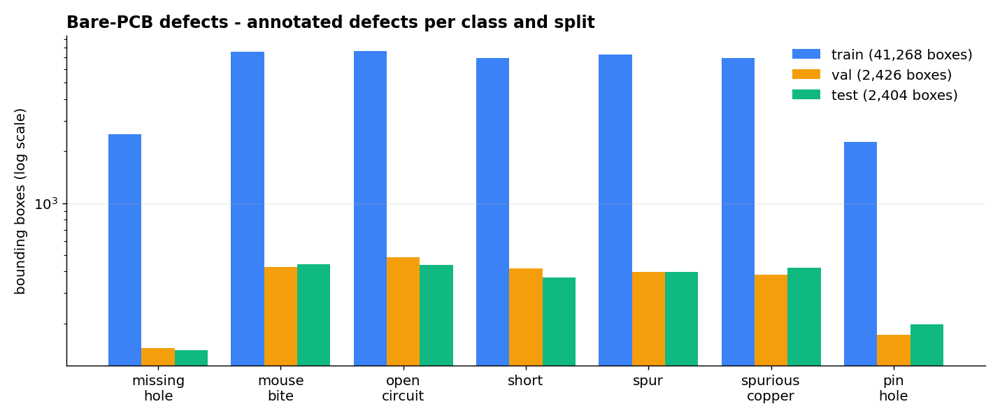

<h1 align="center">Bare PCB Defect Detection — YOLO26</h1>

<p align="center">
  <strong>Inspection of bare (unassembled) printed circuit boards. A YOLO26 detector for the 7 classic copper and drilling defects: missing hole, mouse bite, open circuit, short, spur, spurious copper and pin hole. It is trained on a cleaned merge of PKU-Market-PCB, DeepPCB and web photos.</strong>
</p>

<p align="center">
  
  
  
  
  
  
</p>

<p align="center">
  
  <br><em>Predictions on <b>test</b> boards never used in training or model selection. Top row: PKU-Market-PCB photos. Bottom row: DeepPCB scans. Thin green boxes = ground truth.</em>
</p>

## At a glance

| | |
|---|---|
| **Task** | Detect fabrication defects on bare PCBs (pre-assembly AOI) |
| **Model** | Ultralytics YOLO26s · 9.95 M parameters · 1024 px input · tiled inference for full-resolution scans |
| **Test accuracy** | **mAP@50 0.928 · mAP@50-95 0.617 · Precision 0.902 · Recall 0.883** |
| **Validation accuracy** | mAP@50 0.895 · mAP@50-95 0.601 (best of 50 epochs, epoch 17) |
| **Speed** | ~50 ms per image on a Tesla T4 |
| **Data** | 5,488 unique images, 46,098 boxes, 3 sources, split by board design |
| **Weights** | [`weights/best.pt`](weights/) (20 MB) + per-class thresholds |

## Results on the test set

Each class has its own confidence threshold, tuned for the best F1 score on validation. Recall and precision below are measured with those thresholds on the test set.

| Defect | Test boxes | mAP@50 | mAP@50-95 | Recall | Precision |
|---|---|---|---|---|---|
| `pin_hole` | 197 | **0.985** | 0.874 | 93 % | 96 % |
| `missing_hole` | 139 | **0.976** | 0.581 | 97 % | 94 % |
| `open_circuit` | 439 | 0.921 | 0.569 | 70 % | 98 % |
| `spur` | 397 | 0.918 | 0.557 | 88 % | 89 % |
| `mouse_bite` | 441 | 0.916 | 0.564 | 80 % | 95 % |
| `spurious_copper` | 420 | 0.916 | 0.675 | 90 % | 85 % |
| `short` | 371 | 0.861 | 0.501 | 76 % | 88 % |
| **All classes** | **2,404** | **0.928** | **0.617** | | |

<p align="center">
  
</p>

<p align="center">
  
  
</p>

### What the numbers say

- **Classes are almost never confused with each other.** The confusion matrix is clean: every off-diagonal value between two defect classes is ≤ 2 %. Remaining errors are defects missed entirely (background row) or false alarms on clean copper (background column).
- **`short` is the hardest class** (mAP@50 0.861): 18 % of shorts are missed.
- **`open_circuit` trades recall for precision.** Its validation-tuned threshold (0.77) gives 98 % precision but only 70 % recall. Lower it in `weights/thresholds.json` if a missed open costs more than a false alarm.
- **The model peaked early (epoch 17).** With 18k training files, every class is learned quickly. Later epochs kept validation flat (mAP@50 about 0.87). The limit is the number of distinct board designs, not the number of epochs.
- **Web photos** (the `aaa_hr` source, many different boards at varying quality) are the hardest images: a few of them get no detection at the default thresholds.

## Defect classes

<p align="center">
  
</p>

| Class | Meaning |
|---|---|
| `missing_hole` | a drill hole that was never drilled |
| `mouse_bite` | bite-shaped notch in the edge of a trace |
| `open_circuit` | trace broken through |
| `short` | copper joining two conductors that must stay isolated |
| `spur` | thin copper protrusion from a trace |
| `spurious_copper` | leftover copper island |
| `pin_hole` | small hole inside a copper area |

<p align="center">
  
  <br><em>How small these defects are: the whole board, and the zoomed defect.</em>
</p>

## How it was built

Public PCB-defect datasets are heavily duplicated. An audit of 52 Roboflow datasets found that about 20 of the large ones are resized, cropped or augmented copies of the same **693 PKU-Market-PCB photos**. This dataset is built from originals only:

| Source | Images | Board designs | Notes |
|---|---|---|---|
| PKU-Market-PCB (official, full resolution) | 693 | 10 | official labels |
| DeepPCB | 1,500 | 11 scans | binarised 640 px images |
| Web photos (`aaa_hr`) | 5,135 | 57 groups | 2048 px originals re-cropped, padding removed |

- **Split by board design.** No design appears in two splits, so the test score measures new layouts.
- **De-duplication.** 4,295 pixel-identical files and 617 mirrored or rotated copies were excluded, with every exclusion recorded.
- **Exact 90° copies** of every training image, giving 18,276 training files.

<p align="center">
  
  
</p>

Training used the same stable recipe as the solder model: AdamW with `lr0=5e-4`, `warmup_bias_lr=0`, and a divergence guard. Batch size was 9 on a free Colab T4, at about 17 minutes per epoch. The final model is selected on validation only.

## Quick start

```bash
git clone https://github.com/ParsaVictor/pcb-bare-board-defect-detection-yolo26.git
cd pcb-bare-board-defect-detection-yolo26
pip install -r requirements.txt

python infer/predict.py --weights weights/best.pt --source path/to/boards --out results/run1
```

For each image this writes `<name>_annotated.jpg`, `<name>.json` (class, confidence, box) and a `summary.csv`. Full-resolution scans (for example 3000 × 2000 px PKU photos) are tiled and merged with NMS, so pin holes a few pixels wide are not lost to down-scaling. Per-class thresholds come from `weights/thresholds.json`; `--conf 0.3` overrides them.

```python
from ultralytics import YOLO

model = YOLO("weights/best.pt")
model.predict("board.jpg", imgsz=1024, conf=0.3)[0].save("board_pred.jpg")
```

## Train on Google Colab

Open [`notebooks/Bare_Model_Colab.ipynb`](notebooks/Bare_Model_Colab.ipynb), put `bare_data.zip` (3.9 GB) in Google Drive and choose *Run all*. The notebook shows a live training panel and saves checkpoints to Drive every 2 epochs. It resumes automatically after a disconnect, from any account. At the end it writes the per-class thresholds and a test report.

```bash
python train/train_solder.py --data final_bare --work runs --drive /content/drive/MyDrive/runs/bare \
       --model yolo26s.pt --imgsz 1024 --epochs 50 --patience 20
```

`train_solder.py` is the shared training script of both defect models. To rebuild the dataset: `ROBOFLOW_API_KEY=... python tools/download_versions.py && python tools/aaa_hr.py && python run_pipeline.py`.

## Repository layout

```
weights/     best.pt · thresholds.json · summary.json
infer/       predict.py — tiled inference with per-class thresholds
train/       training script (Drive sync, resume, divergence guard) · live panel
notebooks/   one-click Colab notebook
tools/       audit of 52 public datasets, de-duplication, board-level split, verification
configs/     class taxonomy and source-to-class mapping
results/     results.csv · training curves · confusion matrix · PR curve
docs/        dataset report
```

## FAQ

**Which defects does it find?**
The seven standard bare-board defects: missing hole, mouse bite, open circuit, short, spur, spurious copper and pin hole.

**How accurate is it?**
On test boards with layouts never seen in training: mAP@50 = 0.928 and mAP@50-95 = 0.617. Pin holes and missing holes score highest, at 0.98.

**Is it trained on PKU-Market-PCB or DeepPCB?**
Both, plus about 5,000 web photos of other boards. They are merged into one taxonomy, de-duplicated, and split by board design.

**What about soldering defects on assembled boards?**
Use the companion model [**pcb-solder-defect-detection-yolo26**](https://github.com/ParsaVictor/pcb-solder-defect-detection-yolo26).

## Related repositories

| Repository | What it does |
|---|---|
| [pcb-solder-defect-detection-yolo26](https://github.com/ParsaVictor/pcb-solder-defect-detection-yolo26) | soldering and placement defects after assembly |
| [pcb-component-detection-yolo26](https://github.com/ParsaVictor/pcb-component-detection-yolo26) | locates and identifies every component on a board |
| [pcb-component-classifier](https://github.com/ParsaVictor/pcb-component-classifier) | explainable Random-Forest classifier for component crops |

## Citation

```bibtex
@software{karkooti_2026_bare_pcb_defects,
  author = {Karkooti, Mohammad Parsa},
  title  = {Bare PCB Defect Detection with YOLO26},
  year   = {2026},
  url    = {https://github.com/ParsaVictor/pcb-bare-board-defect-detection-yolo26}
}
```

Please also cite the source datasets: PKU-Market-PCB (Huang & Wei, 2019) and DeepPCB (Tang et al., 2019).

## License

Code and weights are MIT-licensed ([LICENSE](LICENSE)). Source images keep their original licences, listed in [`configs/downloads.csv`](configs/downloads.csv).

**Author:** Mohammad Parsa Karkooti, AI Engineer (Computer Vision) · [GitHub](https://github.com/ParsaVictor) · [LinkedIn](https://www.linkedin.com/in/parsa-karkooti) · [Email](mailto:1.parsa.karkooti@gmail.com)

<sub>Keywords: PCB defect detection, bare board inspection, PKU-Market-PCB, DeepPCB, mouse bite, open circuit, short circuit, spur, spurious copper, missing hole, pin hole, YOLO26, automated optical inspection, AOI, printed circuit board quality control.</sub>
